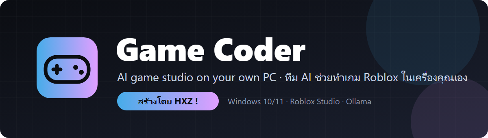
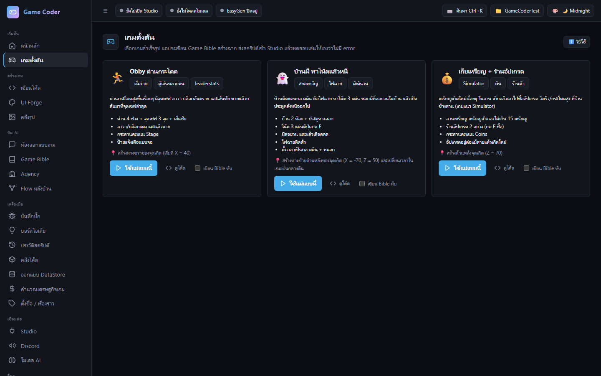
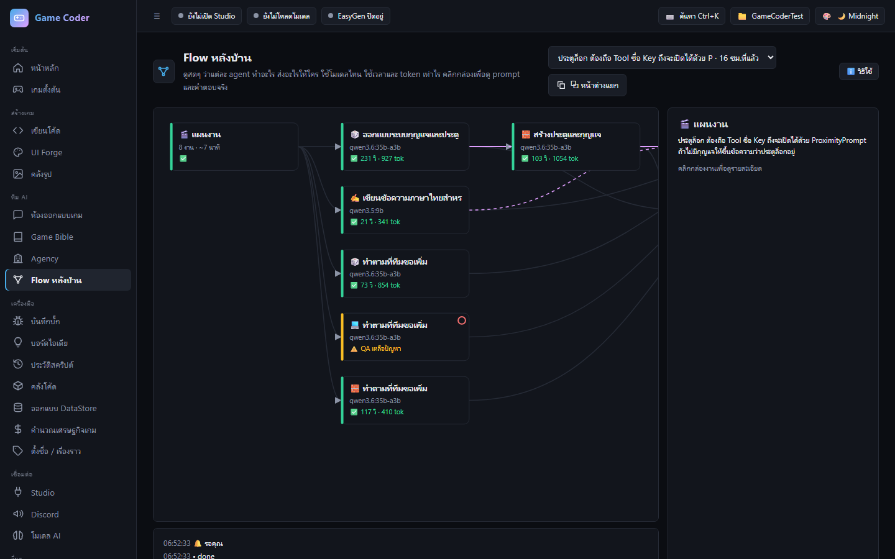
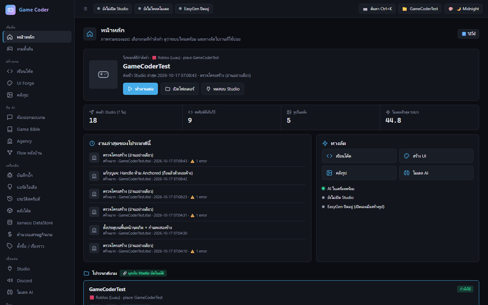
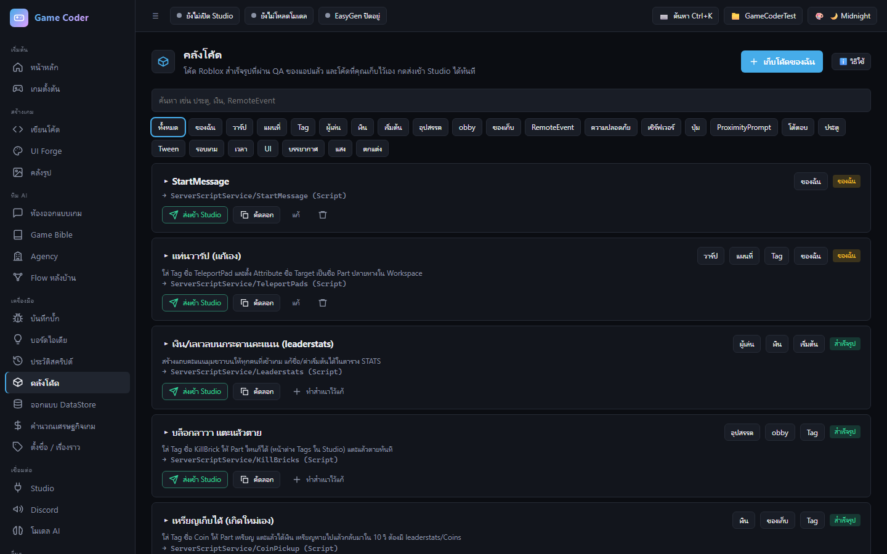
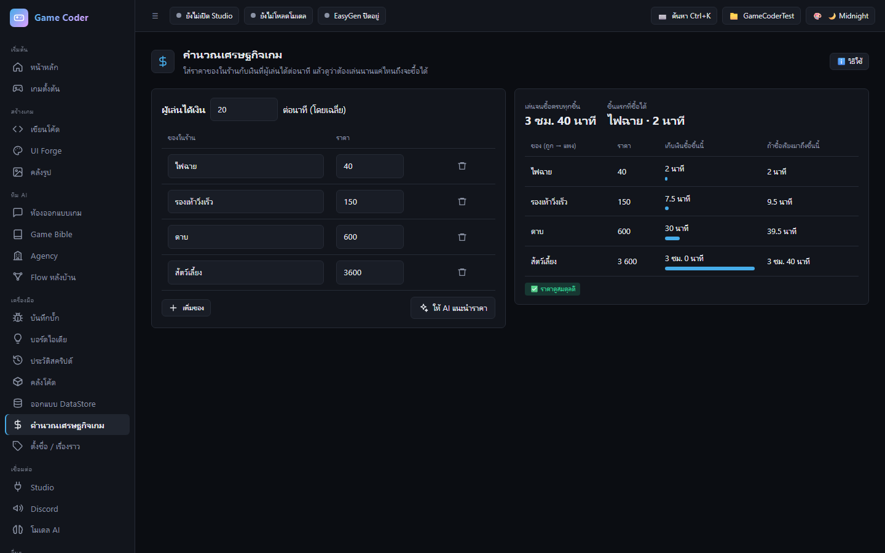
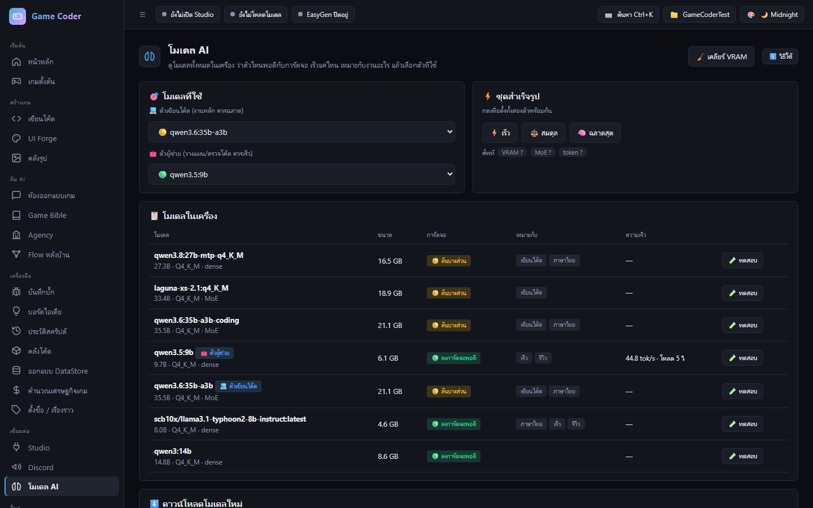

  

  
  
  

<b>สร้างโดย HXZ !</b> · Created by HXZ !

---

## ภาษาไทย · Game Coder คืออะไร

**Game Coder** คือแอปช่วยทำเกม Roblox ด้วย AI ที่รัน**ในเครื่องคุณเอง** (ไม่ต้องจ่ายค่า AI รายเดือน ไม่ส่งงานของคุณขึ้นคลาวด์)
บอกสิ่งที่อยากได้เป็นภาษาไทย แล้วทีม AI จะออกแบบ เขียนโค้ด Luau สร้างฉาก ตรวจบั๊ก และส่งเข้า Roblox Studio ให้

### ✨ ทำอะไรได้บ้าง
| | |
|---|---|
| 🎮 **เกมตั้งต้นสำเร็จรูป** | Obby, บ้านผี, เก็บเหรียญ + ร้านค้า กดปุ่มเดียวได้เกมที่เล่นได้ทันที |
| 🏢 **ทีม AI (Agency)** | นักออกแบบ คนเขียนสคริปต์ ช่างสร้างฉาก ทีม UI และ QA ทำงานร่วมกัน คุณอนุมัติแผนก่อนเสมอ |
| 🔍 **QA ตรวจโค้ดอัตโนมัติ** | กฎตรวจที่สร้างจากบั๊กจริงที่ AI ชอบทำพลาด ก่อนส่งเข้า Studio |
| 🐞 **จับ error จาก Studio** | กด Play แล้ว error สีแดงใน Output กลายเป็นรายการบั๊กเอง พร้อมปุ่มให้ AI แก้ |
| ▶️ **ทดสอบเล่นอัตโนมัติ** | แอปสั่ง Studio กด Play เองแล้วรายงานว่ามี error ไหม |
| 📖 **Game Bible** | เอกสารออกแบบเกมที่ AI ทุกตัวอ่าน ชื่อตัวละครและกฎของเกมจะตรงกันตลอด |
| 📦 **คลังโค้ด / DataStore / เศรษฐกิจเกม / ตั้งชื่อ** | เครื่องมือเล็กๆ ที่คนทำเกมใช้บ่อย |
| 🎨 **UI Forge** | ออกแบบหน้าจอเกมพร้อมรูปจาก AI สร้างภาพในเครื่อง |
| 🔄 **อัปเดตปลอดภัย** | มีเวอร์ชันใหม่แอปจะถามก่อนเสมอ และติดตั้งเฉพาะไฟล์ที่มีลายเซ็นของ HXZ |

### 📸 หน้าตาแอป

  
  
  
  
  
  

### 💻 ต้องมีอะไรบ้าง
- Windows 10 หรือ 11 (64-bit)
- [Roblox Studio](https://create.roblox.com/)
- [Ollama](https://ollama.com/download) สำหรับ AI ในเครื่อง (โหลดโมเดลได้จากหน้า **โมเดล AI** ในแอป)
- การ์ดจอ 8 GB ขึ้นไปแนะนำ (16 GB ใช้ทีม AI ได้เต็มที่)

### ⬇️ วิธีติดตั้ง
1. ไปที่ [Releases ล่าสุด](https://github.com/SxTeddy/gamecoder-updates/releases/latest) แล้วโหลด **`GameCoder-Setup-x.x.x.exe`**
2. ดับเบิลคลิกไฟล์ ถ้า Windows ขึ้นกล่องสีฟ้า "Windows protected your PC" ให้กด **More info → Run anyway** (เพราะไฟล์ยังไม่ได้ซื้อใบรับรองเซ็นโค้ด)
3. กด Next จนเสร็จ ไม่ต้องใช้สิทธิ์ Admin และไม่ต้องติดตั้ง Python
4. เปิด **Game Coder** จาก Desktop → ไปหน้า **Studio** กด **ติดตั้งปลั๊กอิน** แล้วเปิด Roblox Studio

### 🔄 การอัปเดต
เมื่อ HXZ ออกเวอร์ชันใหม่ แอปจะถามว่า **"อัปเดตเลย / ไว้ทีหลัง"** และมีปุ่ม 🔄 บนแถบด้านบน
งาน โปรเจกต์ และการตั้งค่าของคุณไม่หาย แอปสำรองเวอร์ชันเดิมไว้ให้ทุกครั้ง

---

## English · What is Game Coder?

**Game Coder** is an AI game-making app for Roblox that runs **on your own PC** (no monthly AI bill, your work never leaves your computer).
Describe what you want, and a team of AI agents designs it, writes Luau code, builds the map, checks for bugs, and sends it into Roblox Studio.

### ✨ Features
- 🎮 **Starter games:** Obby, haunted house, coin collector + shop. One click, ready to play
- 🏢 **AI team (Agency):** designer, scripter, level builder, UI and QA agents work together. You approve the plan first
- 🔍 **Automatic code QA:** rules built from real mistakes AI models make, checked before anything reaches Studio
- 🐞 **Studio error capture:** red errors in Output become bug cards automatically, with a "let the AI fix it" button
- ▶️ **Auto play-test:** the app presses Play in Studio by itself and reports any errors
- 📖 **Game Bible:** one design document every agent reads, so names and rules stay consistent
- 📦 **Code library, DataStore designer, economy calculator, names & lore**
- 🎨 **UI Forge:** design game screens with images from a local AI image generator
- 🔄 **Safe updates:** the app always asks first and only installs files signed by HXZ

### 💻 Requirements
Windows 10/11 (64-bit) · [Roblox Studio](https://create.roblox.com/) · [Ollama](https://ollama.com/download) · a GPU with 8 GB+ VRAM recommended (16 GB for the full AI team)

### ⬇️ Install
1. Download **`GameCoder-Setup-x.x.x.exe`** from the [latest release](https://github.com/SxTeddy/gamecoder-updates/releases/latest)
2. Run it. If Windows shows "Windows protected your PC", click **More info → Run anyway** (the installer isn't code-signed yet)
3. Click through the installer. No admin rights or Python needed
4. Open **Game Coder** → **Studio** page → **Install plugin**, then open Roblox Studio

---

## © License

**Game Coder - Copyright (c) 2026 HXZ. All rights reserved. สร้างโดย HXZ !**

You may install and use the copies HXZ releases here for personal use.
Copying, redistributing, selling, modifying and passing it off as your own work, or removing the "สร้างโดย HXZ !" credit is not allowed without written permission from HXZ.

ใช้ส่วนตัวได้ ห้ามคัดลอก แจกจ่าย ขาย ดัดแปลงแล้วอ้างเป็นของตัวเอง หรือลบเครดิต "สร้างโดย HXZ !" โดยไม่ได้รับอนุญาตจาก HXZ
